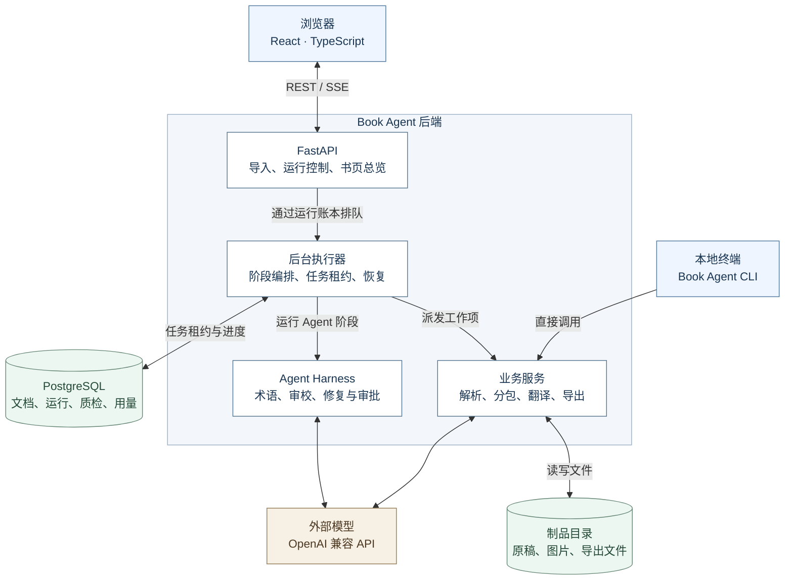
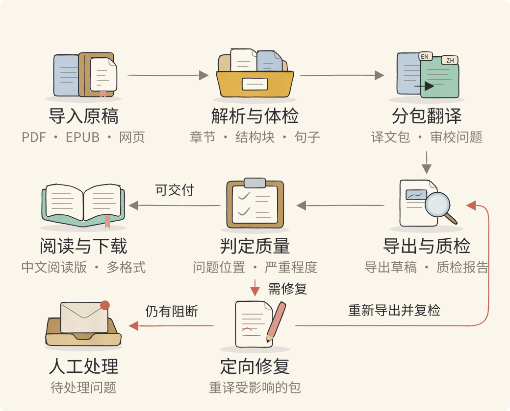

# Book Agent

**把英文书和网页翻译成可直接阅读的中文版。** 上传 PDF、EPUB，或粘贴英文网页链接，即可在书库查看翻译进度、阅读译文和下载文件。

[快速开始](#快速开始) · [系统架构](#系统架构) · [数据流](#数据流) · [使用指南](docs/user-guide.md) · [问题反馈](https://github.com/1055373165/DLERHY/issues)

- **先看试译。** 支持试译前两个可选章节，经过完整质检流程。翻译全书时会复用已完成的试译包。
- **保留阅读结构。** 识别标题、列表、图表、代码和提示框。网页支持输出保留原页面排版的中文版。
- **长任务可以恢复。** PostgreSQL 保存运行进度、工作项和租约。进程重启后，执行器按已记录的状态继续处理待完成工作。
- **质量和用量可查。** 书页展示术语、审校问题和修复结果。填写服务商单价后，可在开始前查看预估，并在运行中统计费用。

## 快速开始

需要 Python 3.12+、[uv](https://docs.astral.sh/uv/)、Node.js 22、npm，以及正在运行的 Docker 和 Docker Compose。

```bash
git clone https://github.com/1055373165/DLERHY.git
cd DLERHY
(set -C
  python3 -c 'import base64, secrets; print("BOOK_AGENT_SECRET_KEY=" + base64.urlsafe_b64encode(secrets.token_bytes(32)).decode())' > .env
)
./book-agent start
```

首次启动需要在 `.env` 保存用于加密服务商凭据的密钥。启动脚本会准备依赖、启动 PostgreSQL、应用数据库迁移，再运行后端和前端。其他设置见 [`.env.example`](.env.example)。

| 本地入口 | 地址 |
| --- | --- |
| 翻译工作台 | [localhost:4173](http://localhost:4173) |
| Swagger API 文档 | [localhost:8999/docs](http://localhost:8999/docs) |
| API 健康检查 | [localhost:8999/v1/health](http://localhost:8999/v1/health) |
| PostgreSQL | `localhost:55432` |

1. 打开工作台，在「设置」中添加 OpenAI 兼容服务商，测试连接后设为当前服务商。填入单价后即可看到费用预估。
2. 在「首页」上传书稿或粘贴链接。打开书页，按提示开始翻译；有试译入口的书稿可以先试译。
3. 在「阅读」中打开结果，或下载中文 HTML、EPUB、Markdown、中英对照 HTML。网页还可下载按原页面排版生成的中文 HTML。

PDF 导出需要额外安装 Chromium（`uv run --extra pdf playwright install chromium`）。扫描件的识别效果取决于 OCR 组件及原件质量。服务管理使用 `./book-agent status`、`./book-agent logs` 和 `./book-agent stop`。 [完整使用指南](docs/user-guide.md)

## 系统架构



FastAPI 提供 [书页总览](src/book_agent/application/book_overview.py)，供前端读取运行状态、可读版本和待处理事项。[后台执行器](src/book_agent/app/runtime/document_run_executor.py) 从 PostgreSQL 领取工作项并记录阶段结果。业务服务与 Agent 将文档结构、译文、质检和用量写入数据库，文件类制品存放在 `artifacts/`。

## 数据流



1. **导入和解析**。将 PDF、EPUB 或网页整理为章节、结构块和句子，并运行解析体检。
2. **分包和翻译**。翻译包携带术语与上下文。返回的译文经校验和审校后组成导出草稿。
3. **质检和交付**。试译和全书流程对草稿执行分层质检。修复流程针对受影响的内容重新处理、导出并复检，仍有阻断问题时在「需要你处理」中提示。

[下载交互版 HTML](docs/diagrams/translation-flow.html?raw=1)，在浏览器中点选各环节查看输入和输出。 [Minicharts](https://april-zhu.com/minicharts) · [图表源码](docs/diagrams/translation-flow.js) · [质量关卡设计](docs/agent-upgrade/08-pilot-quality-gate.md)

## 开发与贡献

| 入口 | 内容 |
| --- | --- |
| [后端](src/book_agent/) | FastAPI、SQLAlchemy、解析与翻译工作流 |
| [前端](frontend/) | React、TypeScript、Vite |
| [数据库迁移](alembic/versions/) | Alembic 迁移 |
| [测试](tests/) | API、工作流、解析与导出回归 |
| [开发交接](docs/HANDOFF.md) | 实现地图、运行约定与已知问题 |
| [部署与生产准备](docs/production/paid-readiness.md) | 部署能力与上线条件 |

```bash
# 后端测试，每个测试文件在独立进程运行
uv sync --extra pdf
scripts/run_tests_per_file.sh

# 前端类型检查与测试
(cd frontend && npx tsc --noEmit -p . && npx vitest run)
```

提交问题时请附可复现步骤、期望结果，以及已去除凭据和版权内容的日志或最小用例。修改枚举、迁移、Agent 工具或 PDF 解析前，请查看 [仓库协作约定](AGENTS.md) 中相应的验证要求。

## 许可

本项目采用 MIT 许可。数据流图的 Minicharts 组件随附[第三方许可](docs/diagrams/minicharts-license.txt)。
