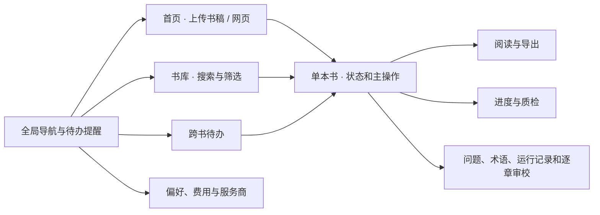

# Book Agent 前端布局规格

2026-11-26 · 与本次前端重构对应。产品流程与运行约定见 [项目交接](../../HANDOFF.md)，试译决策见 [试译质量关](../../agent-upgrade/08-pilot-quality-gate.md)。

## 设计目标

读者进首页通常有两种意图。一种是带着英文书稿或网页来翻译，另一种是回来找已有的中文版。首页分开导入和最近书目，书库继续承载跨书检索，单本书的页面承载翻译状态、质检和阅读。

一个已可阅读的译本也可能附有试译问题。现场检查时，一本已完成的书在正文上方展示了多张试译证据截图，宽屏首屏也看不到正文。新版依据服务端给出的待办类型安排位置。仅含试译问题时，阅读先呈现，页首提供直达问题的入口。暂停、审批等需要用户介入时，待办继续显示在阅读前。

## 参照与取舍

| 参照 | 在 Book Agent 中的应用 |
| --- | --- |
| Android 的自适应导航随窗口尺寸在底栏和侧栏之间切换。 | 同一组有文字的四项入口在窄屏固定于底部，在宽屏进入左侧栏。 [Android Developers](https://developer.android.com/develop/adaptive-apps/guides/build-adaptive-navigation) |
| Apple 的标签栏用于顶级页面导航，当前视图的操作由工具栏承载。 | 「阅读、进度、问题」属于单本书的导航，格式切换和下载留在阅读工具栏。 [Apple Human Interface Guidelines](https://developer.apple.com/design/human-interface-guidelines/tab-bars?changes=_5) |
| GOV.UK 的任务列表让任务名称、说明和状态易于对照。 | 待办一行对应一个问题，呈现书名、问题、证据和服务端提供的操作。 [GOV.UK Design System](https://design-system.service.gov.uk/components/task-list/) |
| WCAG Reflow 用等效 320 CSS 像素衡量窄屏内容重排。 | 浏览器检查将 320 像素纳入验收，长书名、章节位置与表单随宽度重排。独立的阅读框承载原排版。 [W3C WAI](https://www.w3.org/WAI/WCAG22/Understanding/reflow.html) |

## 页面和组件关系

| 模块 | 输入与输出 | 布局与失败反馈 |
| --- | --- | --- |
| 全局导航 | 当前路由、健康检查、待办数量 → 活跃入口及待办提醒 | 860px 及以下使用四项底栏并预留安全区。首次检查中、在线、离线都显示文字。 |
| 首页 | 活跃服务商、最近六条书目和批量概览 → 导入入口、最近书目 | 选文件即导入。网页填写有效链接后提交。模型服务商不可用时引导设置，导入错误在表单内提示，概览加载失败时在对应书目说明。 |
| 书库 | 关键词、书状态、运行状态、可读性、分页 → 列表及每本书的可用操作 | 搜索覆盖标题、作者、源路径和文档 ID。可读书目有独立阅读入口。区分无匹配和请求失败，失败时允许重试。下载菜单按 Esc 关闭并回到触发按钮。 |
| 单本书 | 书籍概览的 `headline`、`primary_action`、`translation`、`needs_you` → 进度、主操作与待办 | 就绪状态用一行摘要，进行中的工作用原生进度条。阅读时，纯试译问题位于阅读框下方，阻塞型待办在阅读框之前。 |
| 阅读框 | 文档来源、导出能力、试译状态、请求格式 → 格式切换、预览和下载 | 选项随真实能力变化。试译标明范围，预览加载与导出失败在阅读区显示。HTML 仍通过带沙箱的 iframe 展示。 |
| 待办与设置 | 待办列表、费用、模型服务商与本机偏好 → 可执行操作、当前配置 | 待办项优先呈现问题和操作。设置按阅读偏好、费用接入、模型服务商组织，窄屏重排为单列。 |

界面共用主题变量、焦点样式、按钮和页面标题层级。正文和进度使用可读性优先的字号与行宽，衬线字用于页面标题。语义色同时搭配文字，运行状态来自现有读模型。

## 状态和接口

现有数据模型以书籍 ID 关联运行、导出和待办。书页用 `GET /v1/documents/{id}/overview` 读取可用操作。首页用 `GET /v1/overviews` 补充最近书目的状态。跨书待办用 `GET /v1/inbox`。导入、翻译、审批与导出沿用现有接口及权限流程。

`GET /v1/documents/history` 接收关键词和筛选参数，返回 `entries`、`total_count` 与 `record_count`。搜索时，在 PostgreSQL 上将文档 UUID 转为字符串后进行不区分大小写的匹配。匹配不到返回空结果，查询失败在书库独立提示。读取可重复执行，导入和审批维持现有的写入语义。

## 验收与风险

| 验收项 | 检查方式 |
| --- | --- |
| 导入、返回书库和打开阅读 | 前端测试验证标有明确文字的路径，真实书库检查直接打开可读译本与加载预览。 |
| 窄屏重排 | 在 320、390、768、1024、1440 CSS 像素检查主界面。外层 `scrollWidth` 应等于 `clientWidth`，定宽的译文内容由阅读框承载。 |
| 能识别界面状态 | 深浅两套主题检查文本、焦点和主要按钮的对比度，常规正文与主要按钮文字至少 4.5:1。 |
| 搜索兼容 PostgreSQL | 在独立测试库检查大写关键词、UUID 前缀及空结果。用真实书库检查分页、搜索和清空。 |
| 保持审核入口 | 打开试译问题入口可找到证据及操作，阻塞待办继续在阅读之前。 |

优先验收的是导入、搜索、阅读和主导航，随后检查深色及长标题，再核对设置、质检和高级标签。主要风险是长标题和章节引用撑宽页面、固定底栏遮住末尾操作，以及搜索错误伪装成空结果。对应的验收点是窄屏不横溢、末尾有安全区、失败与空结果分别显示。点击次数、找书时间和阅读转化缺少线上基线，当前以确定的操作路径和浏览器复测为证据。
